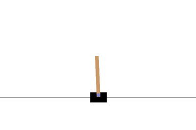
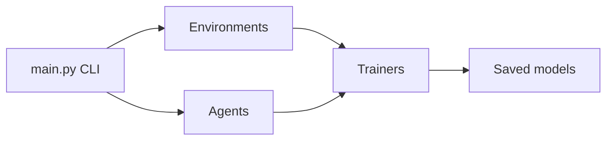
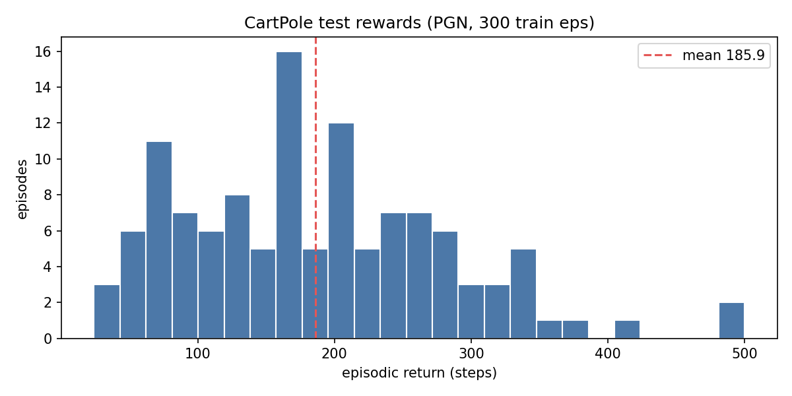

# sb-aiframework


A small reinforcement learning playground written from scratch in PyTorch.
It trains DQN and policy-gradient (REINFORCE) agents on Gymnasium and
PettingZoo environments from a simple command line.



## Features

- Single-agent envs: cartpole, mountain-car, acrobot, lunar-lander, blackjack,
  taxi, cliff-walking, frozen-lake
- Multi-agent envs: tictactoe (`t3`), texas-holdem
- Agents: DQN, DQN2, PGN (REINFORCE), PGNBaseline, Random
- Optional ClearML logging with `--log`

## Architecture



| Part | Location |
|------|----------|
| CLI | `src/main.py` |
| Agents | `src/agents/` |
| Environments | `src/envs/` + Gymnasium / PettingZoo |
| Trainers | `src/trainers/` |
| Testing | `src/test_sa.py`, `src/test_ma.py` |

## Quick start

Requires Python 3.11.

```bash
git clone git@github.com:SauravBastola/sb-aiframework.git
cd sb-aiframework
./build.sh build
./build.sh run gymtrain cartpole --eps 300 --agent PGN
```

After training, the agent is tested for 1000 episodes and a reward histogram
opens. Close the plot window to save the model to `models/`. To skip the window,
prefix the command with `MPLBACKEND=Agg`.

## Commands

| Command | Description |
|---------|-------------|
| `./build.sh build` | Create `.venv` and install dependencies |
| `./build.sh run gymtrain <env> --agent PGN` | Train a single-agent model |
| `./build.sh run gymtest <env> --model ../models/<file>.pth` | Test a saved model |
| `./build.sh run pztrain t3` | Train a multi-agent model |
| `./build.sh run pztest t3` | Test a multi-agent model |
| `./build.sh clean` | Remove `.venv`, runs and models |

## Results

PGN on CartPole after 300 training episodes:



## Known limitations

- DQN has no replay buffer or target network, so it learns slowly. PGN works better.
- Only discrete action spaces are supported.

## License

MIT, see [LICENSE](LICENSE).
